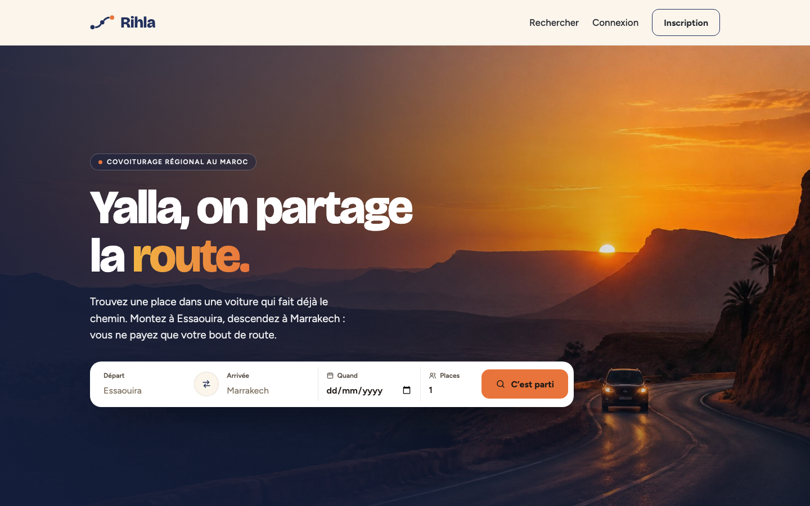
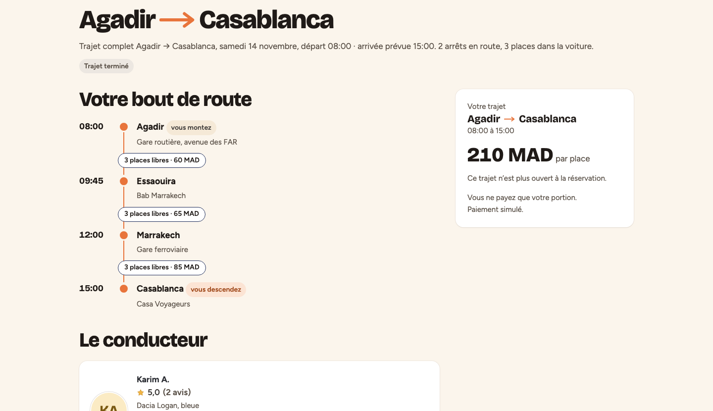
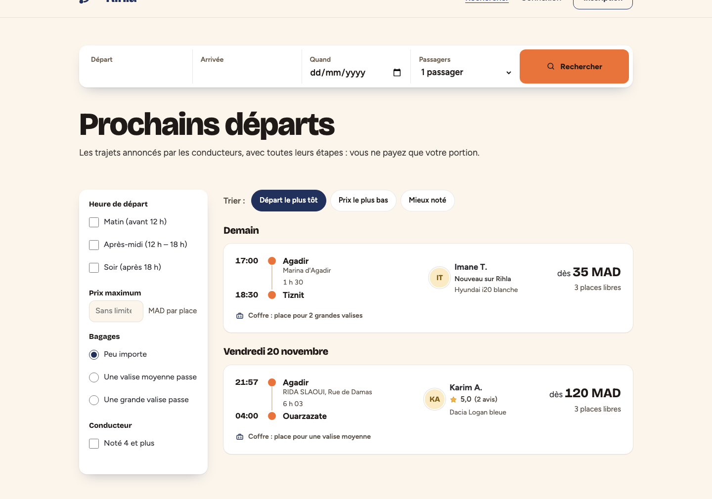
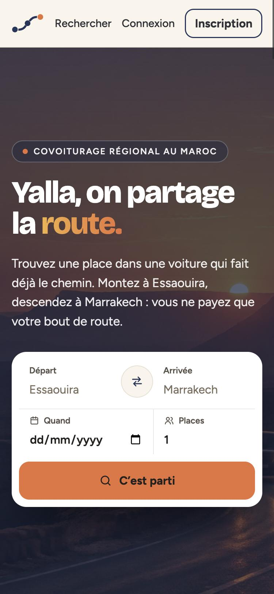
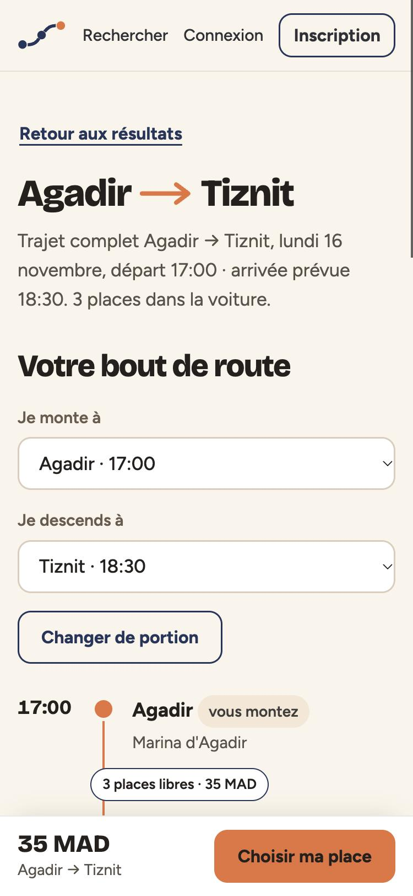

<p align="center">
  
</p>

<h3 align="center">Regional carpooling in Morocco. You only pay for your part of the road.</h3>

<p align="center">
  <em>« Yalla, on partage la route. »</em>
</p>

<p align="center">
  
</p>

---

**Rihla** (رحلة, "journey") connects drivers who already travel between Moroccan cities with passengers who need a seat on **all or part** of their route.

A driver goes Agadir → Essaouira → Marrakech → Casablanca. Youssef rides from Agadir to Essaouira, Salma from Essaouira to Marrakech: **the same seat, sold twice**, and each of them pays only for their own legs. When someone gets off, the seat goes straight back on sale for the rest of the route.

## How it works

<p align="center">
  
</p>

A trip is a chain of **legs**. Each leg has its own price and its own free seats, and everything follows from that:

- **Search by portion.** Look for Essaouira → Marrakech and find the car that goes Agadir → Casablanca.
- **Pay for your legs.** The price of a portion is the sum of its legs. The driver sets them, and Rihla suggests a fair price from the real road distance.
- **Seats follow the legs.** A seat is free on a portion if it is free on every leg of it. Rihla never sells the same seat twice, even when two people book the last one at the same second.

## For passengers

<p align="center">
  
</p>

- **Find a ride** between two cities, or browse « Prochains départs ». Each card draws the route and gives its price « dès » the cheapest leg with a seat.
- **Filter and sort** by departure time, price, luggage space and the driver's rating.
- **Choose your seat** on a plan of the car, and say which bags you bring. Rihla checks they fit in the trunk on your portion.
- **Cancel with clear rules**: full refund up to 24 h before, half after that. You see the amount before confirming.
- **Review the driver** after the trip, and see every driver's rating on their profile.

## For drivers

- **Publish a trip with stops.** Pick each meeting point on a map. Rihla fills in the times from road durations and suggests a price for each leg.
- **See who gets in and out where.** Passengers are listed stop by stop, with the trunk as a checklist of bags to load and unload.
- **Change plans honestly.** Delay the trip or drop a stop: Rihla shows who is affected first, refunds who must be, and lets passengers cancel free of charge from 30 minutes late. Passengers are told by e-mail and under the bell in their header.
- **Track your earnings** in « Mes gains »: earned and upcoming amounts, fill rate, and the seats resold along the way thanks to the legs.
- **Manage your cars.** A car used on past trips is archived, never erased from their history.

## On a phone

<p align="center">
  
  &nbsp;&nbsp;
  
</p>

Every page works from 375 px wide, with touch targets of at least 44 px.

## Try it

Requirements: Docker and Docker Compose.

```bash
docker compose up -d --build
```

Open <http://localhost:8080>. The first start installs everything, runs the migrations and loads the demo data. All demo accounts use the password `rihla2026`, and the login page has one-click buttons for Karim, Salma and Imane.

| Account | Try |
|---|---|
| `salma@rihla.ma` | Passenger: search, book a seat and a suitcase, cancel, review |
| `karim@rihla.ma` | Driver: publish a trip with stops, see passengers per stop, « Mes gains » |
| `admin@rihla.ma` | Back-office at <http://localhost:8080/admin> (admins only see the back-office) |

A five-minute tour:

1. On the home page, search **Agadir → Tiznit**, or open « Rechercher » to see every upcoming departure.
2. Open a trip, pick your boarding and drop-off stops, and see the price change with the legs.
3. « Choisir ma place », sign in as Salma, choose a seat and a suitcase, then « Réserver ».
4. Sign in as Karim and switch to « Conducteur »: the dashboard, the passengers of a trip stop by stop, « Mes gains ».
5. « Publier un trajet »: add a stop and watch the times and prices fill in.
6. As Karim, open an upcoming trip and « Décaler l'horaire ». Then open the demo mailbox at <http://localhost:8025> (linked from the login page) to read the e-mails the passengers got, and sign in as one of them to see the bell.

The full guide (configuration, tests, reset, troubleshooting) is in [`INSTALL.md`](INSTALL.md).

## The challenge

Built for the **EMC PFE Challenge** (Education Media Company, Agadir), **Subject 3: regional carpooling platform**, from 9 to 15 November 2026.

All five levels are done, plus two bonuses: seat choice and luggage. The project has 600 automated tests. What works, the measured performance, the known limits and what comes next are in [`docs/STATUS.md`](docs/STATUS.md).

## Under the hood

- **Symfony 7.4** (LTS) on PHP 8.4, **MySQL 8.4** with Doctrine ORM and migrations
- Twig, Stimulus and Turbo (Symfony UX), AssetMapper: no separate front end
- **OpenStreetMap** services: Nominatim (places) and OSRM (road distances and routes), with Leaflet maps
- EasyAdmin back-office, Docker Compose (PHP-FPM, Nginx, MySQL)
- Bookings lock the trip row (`SELECT … FOR UPDATE`) and recompute seats leg by leg

```bash
docker compose exec php composer test
```

## Documentation

| | |
|---|---|
| [`PRODUCT.md`](PRODUCT.md) | The problem, who Rihla is for, its principles and scope |
| [`docs/STATUS.md`](docs/STATUS.md) | Levels reached, what works, tests, performance, what is left |
| [`docs/MODELE.md`](docs/MODELE.md) | Data model and design choices |
| [`docs/DECISIONS.md`](docs/DECISIONS.md) | Dated decision log, including answers to the brief's open questions |
| [`docs/design/`](docs/design/) | Visual identity: colours, fonts, logo, photos, mockup |
| [`docs/diagrams/`](docs/diagrams/) | Approved design diagrams |
| [`INSTALL.md`](INSTALL.md) | Installation, configuration, tests, troubleshooting |

Code, documentation and commits are in English; the interface is in French, the language of its Moroccan users.

## Built with AI

Rihla was built with AI agents (Claude Code), steered step by step:
- every feature was drawn and approved before any code;
- the tests were written first;
- each change was reviewed in the browser on desktop and on a phone.

Commits produced with AI carry a `Co-Authored-By` trailer. The usage traces are provided separately with the submission.
