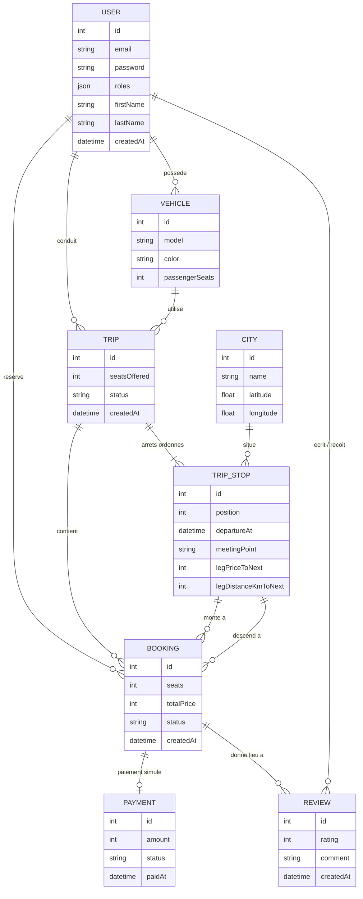

# Modèle de données

> Première version (10 novembre 2026), avant l'implémentation des entités. Elle sera mise à jour au fil du niveau 1.

## Idée centrale : le trajet est découpé en tronçons

```
Agadir ──tronçon 0── Essaouira ──tronçon 1── Marrakech ──tronçon 2── Casablanca
```

Un trajet est une suite ordonnée d'**arrêts** (`TripStop`, avec une `position`). Une réservation va d'un arrêt de départ à un arrêt d'arrivée et occupe donc les tronçons compris entre les deux. Les places libres d'une portion se calculent tronçon par tronçon : c'est le tronçon le plus chargé qui décide.

## Diagramme



## Choix

- **Prix et distance stockés sur l'arrêt, pour le tronçon qui suit** (`legPriceToNext`, `legDistanceKmToNext`). Le prix d'une réservation est figé au moment de la réservation (`Booking.totalPrice`) : une modification ultérieure du prix ne change pas ce qui a déjà été payé.
- **Montants en entiers (MAD)** : pas de flottants pour l'argent.
- **`City` avec latitude et longitude** : sert de cache au géocodage Nominatim, pour ne pas rappeler l'API à chaque recherche.
- **Statuts** (`Trip.status`, `Booking.status`) : énumérations PHP, cycle de vie géré par le composant Workflow de Symfony.
- **Un utilisateur peut être conducteur et passager** : un seul `User`, les rôles découlent de ce qu'il fait (publier un trajet, réserver).
- **Verrou de concurrence** : posé sur la ligne `TRIP` lors d'une réservation (voir `DECISIONS.md`).
