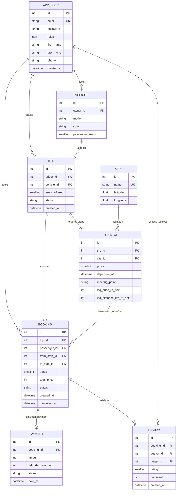

# Data model

> Matches the code as of 10 November 2026 (Level 1). The file keeps the name `MODELE.md` required by the brief.
> The approved design diagrams (classes, booking lifecycle, use cases, booking sequence) are in [`docs/diagrams/`](diagrams/).

## Core idea: a trip is split into legs

```
Agadir ──leg 0── Essaouira ──leg 1── Marrakech ──leg 2── Casablanca
```

A trip is an ordered list of **stops** (`TripStop`, with a `position`). A booking goes from a boarding stop to a drop-off stop, so it occupies every leg between the two. Free seats on a portion are counted leg by leg: the busiest leg decides.

## Diagram



## Rules enforced by the database

| Rule | How |
|---|---|
| One account per email | Unique index on `app_user.email` (+ `UniqueEntity` for a clear form error) |
| One city per name | Unique index on `city.name` |
| One stop per position in a trip | Unique index on `trip_stop (trip_id, position)` |
| One review per booking and author | Unique index on `review (booking_id, author_id)` |
| One payment per booking | Unique foreign key `payment.booking_id` |
| Stops disappear with their trip | `ON DELETE CASCADE` on `trip_stop.trip_id` (and ORM orphan removal) |

## Rules enforced by the validator

- A trip has at least 2 stops and cannot offer more seats than its vehicle has (`Trip::validateSeats`).
- A booking's stops belong to its trip, the drop-off comes after the boarding, and the driver cannot book their own trip (`Booking::validatePortion`).
- Seats: 1 to 6 per vehicle, 1 to 4 per booking; rating 1 to 5; nobody reviews themselves.

## Choices

- **Price and distance stored on the stop, for the leg that follows it** (`legPriceToNext`, `legDistanceKmToNext`, null on the last stop). A booking's price is frozen when it is made (`Booking.totalPrice`): a later price change does not affect what has already been paid.
- **Amounts as integers (MAD)**: no floats for money.
- **`City` with latitude and longitude**: acts as a cache for Nominatim geocoding, so the API is not called again on every search.
- **Statuses as PHP backed enums** (`TripStatus`, `BookingStatus`, `PaymentStatus`) stored as readable strings, with French labels for the interface. Only `CONFIRMED` bookings hold seats.
- **One user can be both driver and passenger**: a single `User`; roles follow from what the person does (publishing a trip, booking a seat). `ROLE_ADMIN` is only for the back-office.
- **Table `app_user`** rather than `user`, which is a reserved word in several SQL dialects.
- **Indexes for the hot queries**: `booking (trip_id, status)` to count seats per trip, `trip_stop (city_id, departure_at)` for search, `trip (status)`.
- **Concurrency lock**: placed on the `trip` row when booking (see [`DECISIONS.md`](DECISIONS.md) and the sequence diagram).
