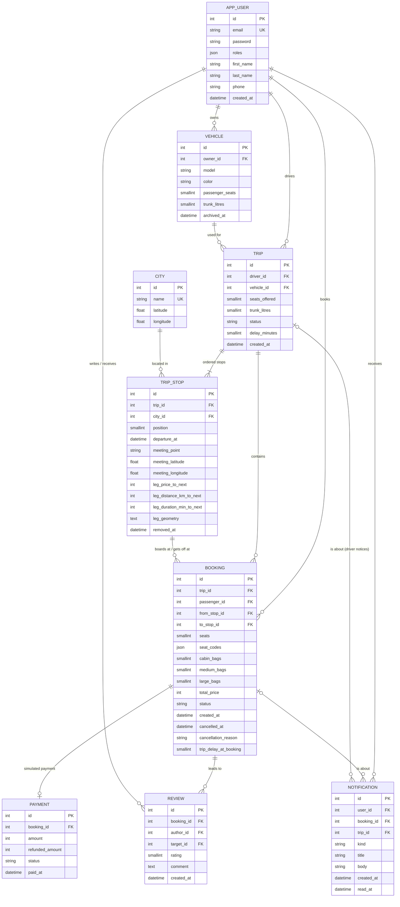

# Data model

> Matches the code as of 15 November 2026 (end of the challenge). The file keeps the name `MODELE.md` required by the brief.
> The approved design diagrams (classes, booking lifecycle, use cases, booking sequence) are in [`docs/diagrams/`](diagrams/); dated reasons are in [`DECISIONS.md`](DECISIONS.md).

## Core idea: a trip is split into legs

```
Agadir ──leg 0── Essaouira ──leg 1── Marrakech ──leg 2── Casablanca
```

A trip is an ordered list of **stops** (`TripStop`, with a `position`). A booking goes from a boarding stop to a drop-off stop, so it occupies every leg between the two. Everything per portion is computed leg by leg:

- **free seats**: seats offered minus the busiest leg of the portion;
- **price**: the sum of the legs' prices;
- **luggage**: the trunk space left on the fullest leg of the portion;
- **seat choice**: a seat is free on a portion if no confirmed booking holds it on any of its legs.

## Diagram



## Entities in one line each

| Entity | Role |
|---|---|
| `User` (`app_user`) | One account for a person, passenger and driver alike; `ROLE_ADMIN` only for the back-office |
| `Vehicle` | A driver's car: passenger seats (1 to 6) and trunk volume; archived rather than deleted once used |
| `City` | A Moroccan city with its coordinates, the cache of geocoding |
| `Trip` | A published journey: driver, car, seats offered, trunk volume, status, accumulated delay |
| `TripStop` | A stop of a trip, in order, with its meeting point and the leg that follows it (price, distance, duration, road line) |
| `Booking` | A passenger's portion of a trip: stops, seats, chosen seats, bags, frozen price, status |
| `Payment` | The simulated payment of a booking, and what was refunded |
| `Review` | A rating from 1 to 5 after a completed trip, passenger about driver or driver about passenger |
| `Notification` | A notice shown under the bell. For passengers: a delay, a removed stop, a cancelled trip. For drivers: a new booking, a passenger's cancellation, a trip cancelled by Rihla. For anyone: a new review. Linked to the booking and, for drivers, the trip |

## Lifecycles

| | States | Moves |
|---|---|---|
| **Trip** | `PUBLISHED` → `COMPLETED` or `CANCELLED` | Completed once the time of its last stop has passed (`app:trips:complete`, also run by the pages); cancelled by its driver or from the back-office before it leaves |
| **Booking** | `CONFIRMED` → `COMPLETED`, `CANCELLED_BY_PASSENGER` or `CANCELLED_BY_DRIVER` | Completed with its trip; cancelled by the passenger (refund by the rules), or by the driver: trip cancelled, or its stop removed (`cancellation_reason` says which) |
| **Payment** | `PAID` → `PARTIALLY_REFUNDED` or `REFUNDED` | Follows the refund of its booking |

Only `CONFIRMED` bookings hold seats and trunk space.

## Rules enforced by the database

| Rule | How |
|---|---|
| One account per email | Unique index on `app_user.email` (+ `UniqueEntity` for a clear form error) |
| One city per name | Unique index on `city.name` |
| One stop per position in a trip | Unique index on `trip_stop (trip_id, position)`; a removed stop has no position, so it never collides |
| One review per booking and author | Unique index on `review (booking_id, author_id)` |
| One payment per booking | Unique foreign key `payment.booking_id` |
| Stops disappear with their trip | `ON DELETE CASCADE` on `trip_stop.trip_id` (and ORM orphan removal) |
| A deleted account takes its cars and notices with it | `ON DELETE CASCADE` on `vehicle.owner_id` and `notification.user_id` |
| A notice survives its booking or trip | `ON DELETE SET NULL` on `notification.booking_id` and `notification.trip_id` |

## Rules enforced by the validator and the services

- A trip has at least 2 stops and cannot offer more seats than its car has (`Trip::validateSeats`).
- A booking's stops belong to its trip, the drop-off comes after the boarding, and the driver cannot book their own trip (`Booking::validatePortion`).
- Seats: 1 to 6 per car, 1 to 4 per booking; rating 1 to 5; nobody reviews themselves (`Review::validateParties`).
- Booking locks the trip row, then recomputes seats, chosen seats and trunk space on every leg of the portion (`BookingService`).
- A delay is 15 minutes to 3 hours at a time, never earlier, 6 hours at most in total; only an intermediate stop can be removed (`TripChangeService`).

## Choices

- **Price and distance stored on the stop, for the leg that follows it** (`legPriceToNext`, `legDistanceKmToNext`, `legDurationMinToNext`, `legGeometry`; null on the last stop). The road data comes from OSRM once, when the trip is published (and again for the merged leg when a stop is removed), so search and trip pages never call it.
- **A booking's price is frozen when it is made** (`Booking.totalPrice`): a later change does not affect what has been paid. When a stop is removed, a passenger riding through keeps their price; the two legs become one at their summed price.
- **Amounts as integers (MAD)**: no floats for money.
- **Seats offered and trunk volume are copied onto the trip** when it is published (`Trip.seatsOffered`, `Trip.trunkLitres`), so editing or archiving the car never changes a trip already booked.
- **Chosen seats as codes** (`seat_codes`, e.g. `["A1", "B3"]`) on a fixed plan of the car: `A1` beside the driver, `B1 B2 B3` behind, `C1 C2` for a third row (`SeatLayout`). Bookings made before seat choice existed have none.
- **Bags as counts per size** (cabin 40 L, medium 70 L, large 100 L, `LuggageSize`) rather than litres: passengers think in suitcases; the litres are only used to check the trunk.
- **Exact meeting points** (`meeting_latitude`, `meeting_longitude`) picked on a map; the city's centre is the fallback.
- **Soft removal where history matters**: a used car gets `archived_at`; a stop removed after bookings gets `removed_at` and loses its position. Cancelled bookings still point to them, and every calculation ignores them.
- **`delay_minutes` on the trip** keeps the total delay; **`trip_delay_at_booking` on the booking** keeps how late the trip already was when the passenger booked. A passenger's delay is the difference: someone who books an already delayed trip has booked the new time. From 30 minutes of their own delay, they cancel free of charge.
- **`City` with latitude and longitude** acts as a cache for Nominatim geocoding, so the API is not called again on every search.
- **Statuses as PHP backed enums** (`TripStatus`, `BookingStatus`, `PaymentStatus`) stored as readable strings, with French labels for the interface.
- **One user can be both driver and passenger**: a single `User`; the role follows from what the person does. The interface switches between a passenger space and a driver space.
- **Table `app_user`** rather than `user`, which is a reserved word in several SQL dialects.
- **Indexes for the hot queries**: `booking (trip_id, status)` to count seats per trip, `trip_stop (city_id, departure_at)` for search, `trip (status)`. List pages load stops, bookings and ratings in grouped queries (no query per trip, checked by tests).
- **Concurrency lock**: placed on the `trip` row when booking, delaying, removing a stop or cancelling (see [`DECISIONS.md`](DECISIONS.md) and the sequence diagram).
