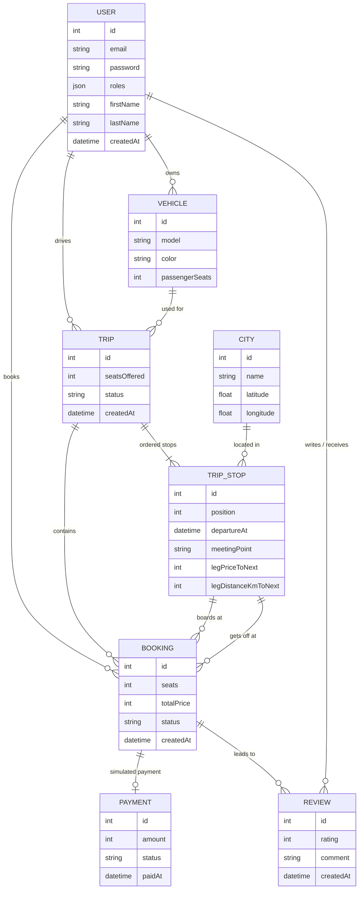

# Data model

> First version (10 November 2026), written before the entities were implemented. It will be updated during Level 1. The file keeps the name `MODELE.md` required by the brief.

## Core idea: a trip is split into legs

```
Agadir ──leg 0── Essaouira ──leg 1── Marrakech ──leg 2── Casablanca
```

A trip is an ordered list of **stops** (`TripStop`, with a `position`). A booking goes from a boarding stop to a drop-off stop, so it occupies every leg between the two. Free seats on a portion are counted leg by leg: the busiest leg decides.

## Diagram



## Choices

- **Price and distance stored on the stop, for the leg that follows it** (`legPriceToNext`, `legDistanceKmToNext`). A booking's price is frozen when it is made (`Booking.totalPrice`): a later price change does not affect what has already been paid.
- **Amounts as integers (MAD)**: no floats for money.
- **`City` with latitude and longitude**: acts as a cache for Nominatim geocoding, so the API is not called again on every search.
- **Statuses** (`Trip.status`, `Booking.status`): PHP enums, with the lifecycle managed by Symfony's Workflow component.
- **One user can be both driver and passenger**: a single `User`; roles follow from what the person does (publishing a trip, booking a seat).
- **Concurrency lock**: placed on the `TRIP` row when booking (see `DECISIONS.md`).
